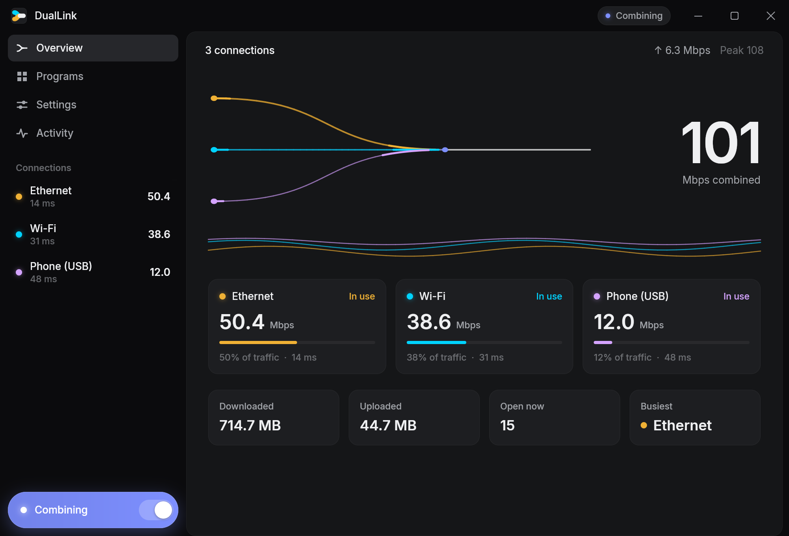
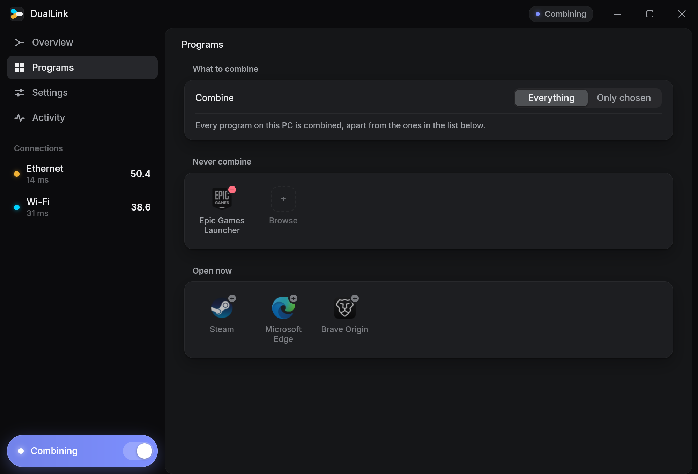
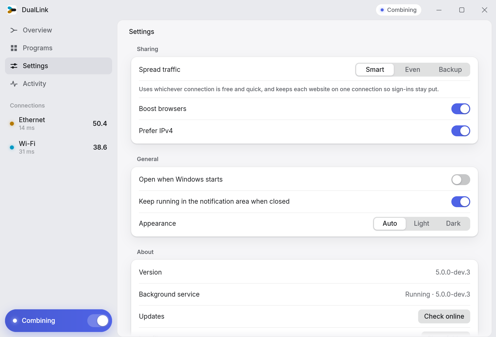
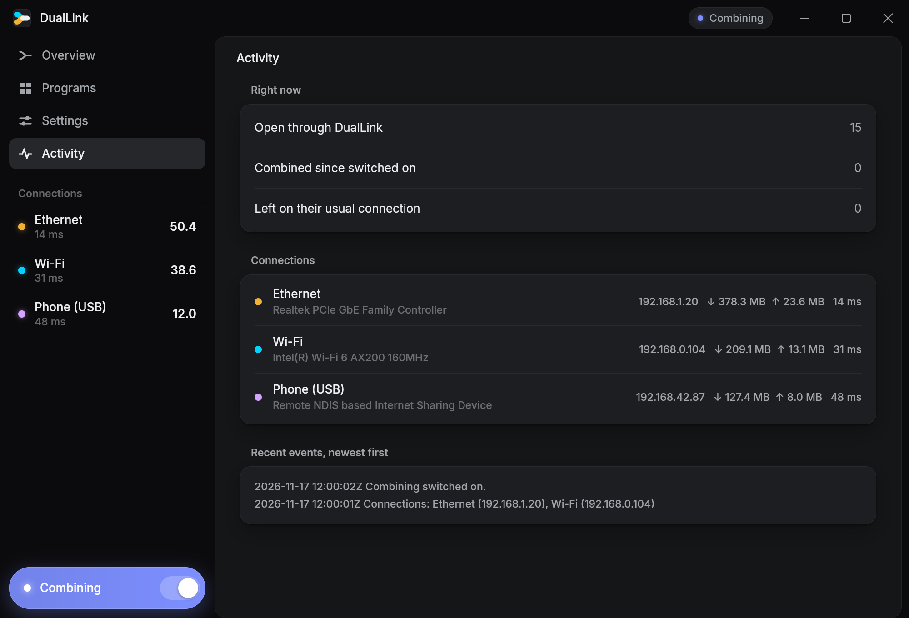
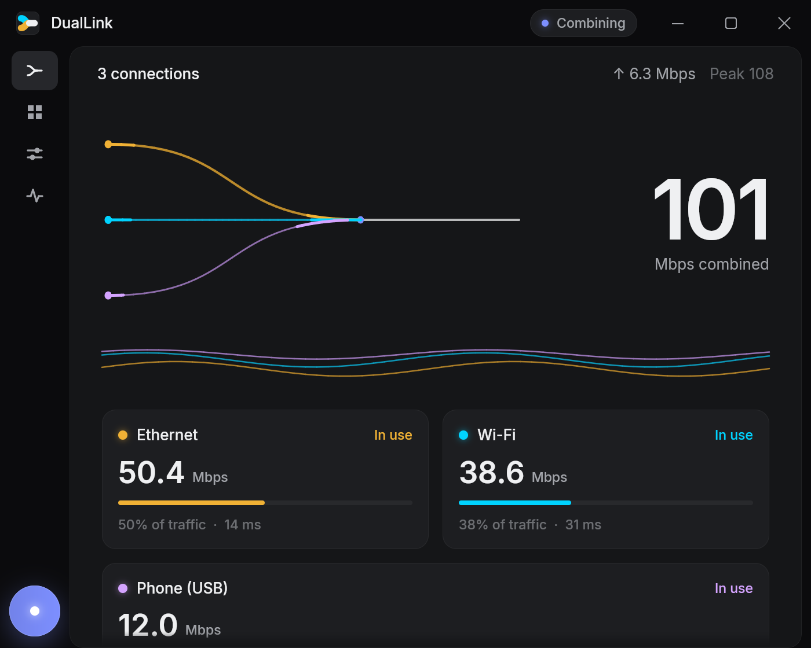

# DualLink

[](LICENSE)
[](#requirements)

DualLink combines your PC's internet connections. Plug in Ethernet, join Wi-Fi, tether a phone over USB, and DualLink spreads your downloads across all of them at once.



<sub>Screenshots use sample data.</sub>

## Download

Get the offline installer from [GitHub Releases](https://github.com/Vansh-Bhardwaj/DualLink/releases/latest). It includes the network driver and everything else DualLink needs. Check it against the published `SHA256SUMS.txt` before running it.

## DualLink 5: rebuilt from the ground up

DualLink 5 is a complete rewrite in native Rust, with a new GPU-drawn interface. DualLink 4 sent traffic through a separate filter service and a local proxy, started an elevated helper every time you pressed Start, and only knew about one Ethernet and one Wi-Fi connection. DualLink 5 replaces all of that with one small background service that does the work itself.

| | DualLink 4.2 | DualLink 5 |
|---|---|---|
| Connections | One Ethernet and one Wi-Fi | Any number: Ethernet, Wi-Fi, phones on USB, mobile data |
| What gets combined | Programs you picked | Everything, or only programs you pick |
| Background parts | Window, elevated helper, watchdog, and a separate filter service | Window and one service |
| Administrator prompt | Every time you pressed Start | Once, when installing |
| If something stops | Traffic could stay pointed at a helper that was gone until the watchdog stepped in | Windows releases the driver and the adapters return to normal on their own |
| Installer | 124 MB | 31 MB |
| Installed size | 156 MB plus the filter service | 23 MB |
| Window: time to open | 1.7 s | under 0.1 s |
| Window: memory | 327 MB working set, 199 MB private | 110 MB working set, 136 MB private |
| Window: CPU while idle | 0.30% of the PC | 0.04% of the PC |
| Window: handles | 1,032 | 487 |
| Service while idle | — | 14 MB working set, 7 MB private |

Measured on the same PC (Ryzen 5 5600H, 12 threads, Windows 11) with each window open, sampled each second for 20 seconds after a 10-second settle. The DualLink 4 figures are for its window only, because its helper and filter service could not be measured side by side.

What else is new:

- **Phones and more.** Every connection Windows has is listed, each tied to its own adapter, so two phones that hand out the same address range still work as separate links.
- **System-wide.** Combine everything on the PC and list the few programs to leave alone, or combine only the programs you choose. Each choice keeps its own list, and programs show with their real icons and names.
- **Browsers combine too.** Browsers often use QUIC and IPv6, which can't be spread across links. DualLink can steer them back to connections it can combine; both options are in Settings.
- **Smarter sharing.** Smart mode keeps sign-ins on one address but spreads a download that opens many connections to one server across every link. In a test with eight parallel downloads from one server over Ethernet and a phone hotspot, it finished in 6.1 seconds instead of 10.0 on Ethernet alone.
- **A window you can read at a glance.** Each connection is a thin line in its own colour running into one line that ends at the combined speed, with pulses travelling along each line while it carries traffic. Cards show each connection's speed, its share of the traffic and how quickly it answers.
- **Native-feeling.** DualLink draws its own title bar, keeps Windows snap and resize, follows light and dark mode, fits windows down to 640 × 480, and stays in the notification area when closed.

## How it works

The DualLink service watches new outgoing connections on the connections you use. When a program opens one that DualLink should combine, the service takes it over, picks a connection for it, and opens the real connection there. The program sees nothing different. Everything else, including your local network, is left exactly as Windows sends it.

A connection stays on the link it started on for its whole life. Combining comes from spreading many connections over the links, which is how game launchers, download managers and browsers already download.

| Sharing | What it does |
|---|---|
| **Smart** | Picks the connection that is free and quick, and keeps each website on one connection so sign-ins stay put, until a download opens several connections at once. |
| **Even** | Shares new connections in turn, following each connection's share. |
| **Backup** | Uses the first connection; the others step in only if it drops. |

Each connection can have its own share, speed limit and place in the list.

## Everyday use

1. Connect at least two internet connections with separate lines, for example Ethernet and a phone.
2. Open DualLink and switch **Combining** on at the bottom of the sidebar.
3. Watch the overview: busier connections pulse faster, and the number on the right is the combined speed.
4. In **Programs**, choose **Everything** or **Only chosen**, and add programs from the ones open on screen or with **Browse**.
5. Click a connection to change its share or limit, or to stop using it.

<table>
<tr>
<td></td>
<td></td>
</tr>
<tr>
<td></td>
<td></td>
</tr>
</table>

## Limits

- One connection can't be split across two links without a server at the other end that joins them back together. A single download speeds up only when it opens several connections; many download managers let you choose how many.
- Two connections through the same router share one internet line, so combining them can't add speed. Use links with separate lines, such as a phone on mobile data.
- DualLink combines IPv4 TCP. UDP traffic, including most live game traffic, keeps its usual path.
- Not yet tested: sleep and wake while combining, and unplugging a connection mid-download.

## Safety

- The service runs as a standard Windows service and starts with Windows. The window runs with your normal permissions and talks to the service over a local pipe that only people signed in at this PC can use.
- Turning combining off, stopping the service or uninstalling returns all traffic to normal. Because one process does everything, there's nothing else left behind to point traffic at a part that has stopped.
- The service only accepts connections it turned around itself; anything else that reaches it is closed. Setup adds a Windows Firewall rule for this, and uninstalling removes it.

## Build from source

You need Windows 10 or 11 x64, Rust (stable, MSVC), the Visual Studio C++ Build Tools and Inno Setup 6.

```powershell
cargo test --workspace
.\tools\Package-Native.ps1
```

`Package-Native.ps1` lints, tests, builds the release, refreshes the third-party notices, and writes the installer, the SBOM and `SHA256SUMS.txt` to `dist\release`. The code is in `crates/`:

- `duallink-core`: the router, connection tracking, packet rewriting, adapter discovery and the messages between the window and the service.
- `duallink-service`: the Windows service and its packet engine.
- `duallink-app`: the window.

DualLink 4's .NET code stays in `src/` for reference until it is removed. See the [release policy](docs/RELEASE-POLICY.md) before distributing a build.

## Requirements

- Windows 10 or Windows 11, x64
- Two or more internet connections, ideally on separate lines
- Administrator approval once, to install

## Legal and security

DualLink is released under [AGPL-3.0-only](LICENSE). The window is drawn with [Rune](https://github.com/anomalyco/rune) (MIT). Review the [privacy statement](PRIVACY.md), [security policy](SECURITY.md) and [third-party notices](THIRD-PARTY-NOTICES.md). Release executables are currently unsigned; verify the published SHA-256 checksums before running them.
