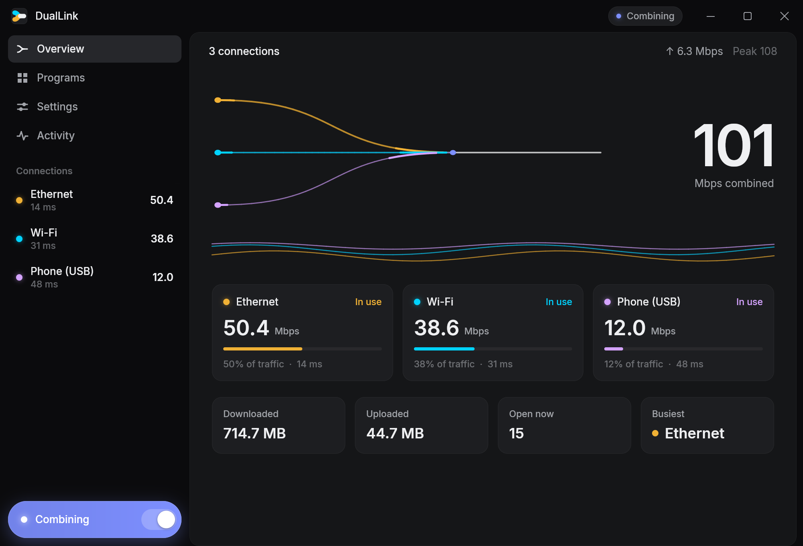

# DualLink 5.0.0

DualLink 5 is a complete rewrite in native Rust with a new interface. It combines any number of internet connections, for everything on your PC or only the programs you choose.

## Highlights

- **Any number of connections:** Ethernet, Wi-Fi, phones on USB and mobile data, each tied to its own adapter.
- **System-wide or per program:** combine everything apart from a list of programs, or only the programs you choose. Each choice keeps its own list.
- **One small service instead of four parts:** no separate filter service, no local proxy, no watchdog, and no administrator prompt each time you start combining.
- **Smart sharing that combines downloads:** a download that opens several connections to one server is spread across your links, while sign-ins stay on one address.
- **New window:** thin animated lines for each connection run into the combined speed. Connection cards, Programs, Settings and Activity pages, its own title bar, light and dark mode, and a notification-area icon.

## Lighter

Measured on the same PC, window open and idle:

| | DualLink 4.2 | DualLink 5.0 |
|---|---|---|
| Installer | 124 MB | 31 MB |
| Installed | 156 MB plus filter service | 23 MB |
| Window opens | 1.7 s | under 0.1 s |
| Window memory (private) | 199 MB | 136 MB |
| Window idle CPU | 0.30% | 0.04% |

## Upgrading from DualLink 4

Run the installer. It removes DualLink 4's helper and watchdog, and installs and starts the DualLink 5 service. DualLink 4 settings aren't carried over. ProxiFyre is no longer used; remove it from **Settings > Apps** if nothing else needs it.

## Known limits

- Sleep and wake while combining, and unplugging a connection mid-download, haven't been tested yet.
- DualLink combines IPv4 TCP. A single connection can't be split across links.
- DualLink 5 doesn't update itself; **Check online** in Settings opens this page.
